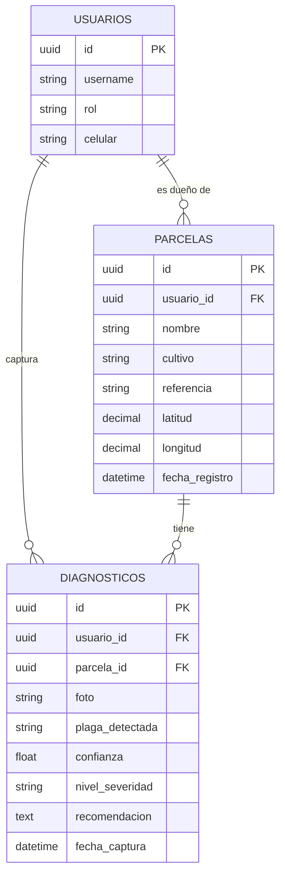

# HU-05: Modelo de datos del servidor y API del historial por parcela

## Modelo de datos (MySQL, creado por las migraciones de Django)



## Equivalencia con la base local del celular (Room)

| Room (celular) | Servidor (Django/MySQL) | Nota |
|---|---|---|
| diagnosticos.ruta_foto | diagnosticos.foto | El servidor guarda el archivo de imagen, no una ruta del celular |
| diagnosticos.estado_sincronizacion | no existe | Solo tiene sentido en el celular |
| usuarios.rol | usuarios.rol | AGRICULTOR o AGRONOMO |
| parcelas.* | parcelas.* | Mismos campos |
| usuario_id = "usuario_local" | usuario_id (UUID) | Provisional: al sincronizar se debe reemplazar por el usuario real |

El id de cada registro es un UUID generado en el celular. Django lo guarda sin guiones
en MySQL (CHAR(32)) y la API siempre lo entrega con guiones, igual que Room.

## Endpoints (requieren sesión iniciada)

| Método | Ruta | Qué devuelve |
|---|---|---|
| GET | /api/parcelas/ | Lista de parcelas con su cantidad de diagnósticos |
| GET | /api/parcelas/{id}/historial/ | Parcela, resumen y diagnósticos del más reciente al más antiguo |

Filtros opcionales del historial: `?desde=AAAA-MM-DD&hasta=AAAA-MM-DD`.
Errores: 400 si la fecha es inválida, 404 si la parcela no existe, 403 si no hay sesión.

## Ejemplo de respuesta de /api/parcelas/{id}/historial/

```json
{
  "parcela": {
    "id": "3f2b...",
    "nombre": "Finca Sol Naciente",
    "cultivo": "Papa",
    "referencia": "Chosica",
    "latitud": -11.9333,
    "longitud": -76.7,
    "agricultor": "Luis Quispe",
    "total_diagnosticos": 6
  },
  "resumen": {
    "total": 6,
    "ultima_fecha": "2026-10-28T14:30:00-05:00",
    "por_plaga": {
      "Potato___Late_blight": 3,
      "Potato___healthy": 3
    }
  },
  "diagnosticos": [
    {
      "id": "a91c...",
      "fecha_captura": "2026-10-28T14:30:00-05:00",
      "plaga_detectada": "Potato___Late_blight",
      "plaga_nombre": "Tizón tardío",
      "confianza": 97.8,
      "nivel_severidad": "ALTA",
      "recomendacion": "Actúa de inmediato...",
      "foto_url": "http://127.0.0.1:8000/media/diagnosticos/2026/10/a91c.jpg"
    }
  ]
}
```

`confianza` va de 0 a 100, igual que en el celular.
